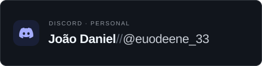

  
  &nbsp;
  

  

---

### 👋 About Me

Hey! I'm **João Daniel Nobre Finotti**, also known as **RIQUINHO**. I'm into technology, programming, and building digital projects. I enjoy exploring ideas, learning new tools, and turning concepts into projects while continuing to improve my skills.

Here I share my projects, experiments, and interests in software development. Check out the links below to follow my work or get in touch.

---

### 🛠️ Technologies & Stack

<strong>Languages:</strong>

<table>
  <tr>
    <td></td>
    <td></td>
    <td></td>
  </tr>
</table>

<strong>Web & Ecosystem:</strong>

<table>
  <tr>
    <td></td>
    <td></td>
    <td></td>
    <td></td>
    <td></td>
    <td></td>
    <td></td>
  </tr>
</table>

<strong>3D & FiveM:</strong>

<table>
  <tr>
    <td></td>
    <td></td>
    <td></td>
  </tr>
</table>

<strong>Environments & Tools:</strong>

<table>
  <tr>
    <td></td>
    <td></td>
  </tr>
</table>

---

### 🐍 RIQUINHO · Pixel Art

  

---

### 💬 Contact

<table width="100%">
  <tr>
    <td width="50%" align="center">
      
    </td>
    <td width="50%" align="center">
      
    </td>
  </tr>
</table>

  <a href="https://github.com/danielfinotti2-spec">GitHub: danielfinotti2-spec</a>
  &nbsp;·&nbsp;
  <a href="https://instagram.com/euodeene_33">Instagram: @euodeene_33</a>
  &nbsp;·&nbsp;
  <a href="https://discord.gg/sZzTm8BC58">Discord: join the server</a>

