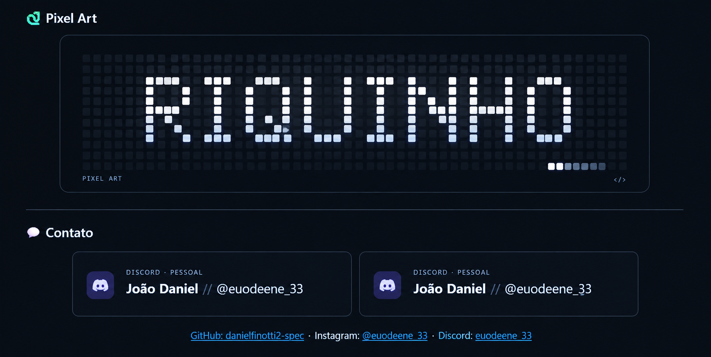

  
  &nbsp;
  

  

---

### 🚀 Sobre Mim

* 💻 **Desenvolvimento:** projetos e soluções de software.
* 🧩 **Tecnologia:** explorando ferramentas, linguagens e novas ideias.
* 🌐 **GitHub:** meus projetos e experimentos estão no meu perfil.

---

### 🛠️ Tecnologias & Stack

<strong>Linguagens:</strong>

<table>
  <tr>
    <td></td>
    <td></td>
    <td></td>
  </tr>
</table>

<strong>Web & Ecossistema:</strong>

<table>
  <tr>
    <td></td>
    <td></td>
    <td></td>
    <td></td>
    <td></td>
    <td></td>
    <td></td>
  </tr>
</table>

<strong>3D & FiveM:</strong>

<table>
  <tr>
    <td></td>
    <td></td>
    <td></td>
  </tr>
</table>

<strong>Ambientes & Ferramentas:</strong>

<table>
  <tr>
    <td></td>
    <td></td>
  </tr>
</table>

---

### ✨ Perfil & Contato

  

  
  &nbsp;
  

